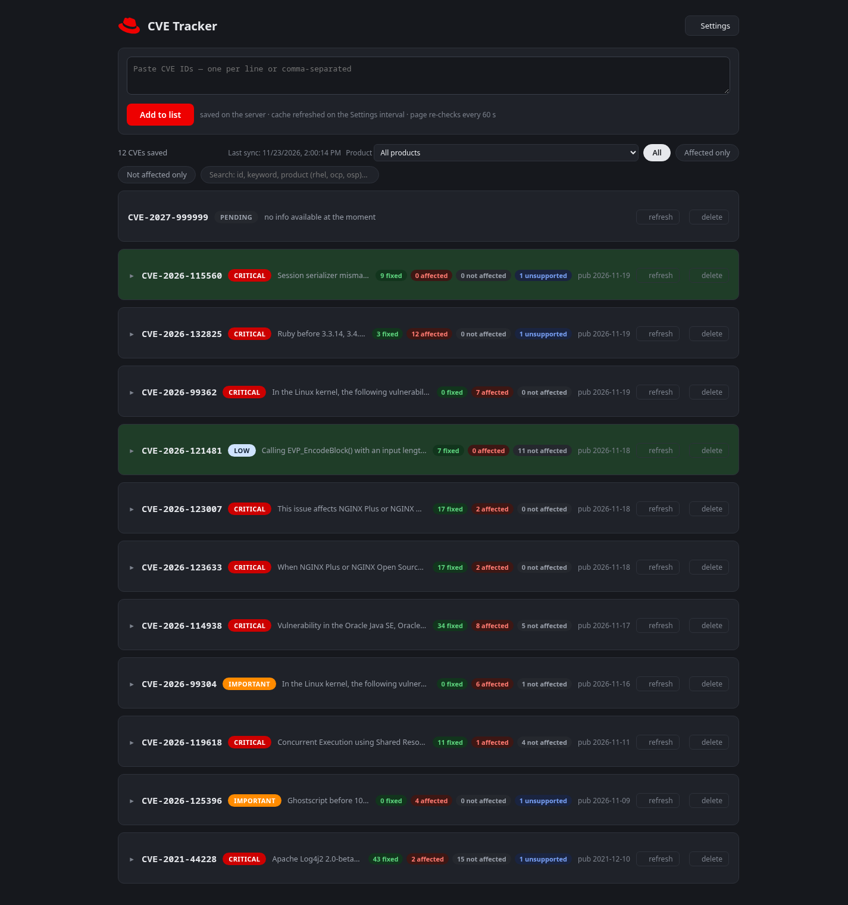

# CVE Tracker

A single-file, dependency-free CVE tracker: a stdlib-Python web app on top of
the [Red Hat Security Data API](https://access.redhat.com/documentation/en-us/red_hat_security_data_api/).

Tracks a saved list of CVEs, normalizes `affected_release` / `package_state`
into per-product rows (fixed / affected / not affected), and caches the raw API
responses on disk. The UI is fully embedded in the Python file — no build step,
no JS framework, no database.



## File guide

| Path | Purpose |
|---|---|
| `app/server.py` | The whole application: HTTP server (`http.server`), embedded HTML/CSS/JS UI, Red Hat API client, on-disk cache, background refresher thread, settings handling. Run it directly (`python server.py`) or via the quadlet below. Honors `PORT` and `DATA_DIR` env vars. |
| `cvetracker.container` | Podman quadlet unit — the systemd-native way to run the app as a container. Bind-mounts `app/` read-only and `data/` read-write into a stock `python:3.12-slim` image, runs as uid 1001, publishes `127.0.0.1:8897`, auto-updates the image from the registry. |
| `cvetracker.example.com.conf` | nginx vhost — TLS termination and reverse proxy for the public hostname. Uses a *variable* `proxy_pass` with `resolver 10.89.1.1` (the podman network gateway) so nginx resolves the container name at request time and needs no reload after container restarts. |
| `data/cves.json` | The saved CVE list (`{"order": [...]}`) — the app's only "database" for what you track. Ships with demo entries. |
| `data/settings.json` | Server-side settings so they follow across browsers: `refresh_min` (cache TTL: 30/60/120/180), `theme` (light/dark), `product` (selected filter), `last_sync`, and proxy config (`proxy_enabled`, `proxy_host`, `proxy_user`, `proxy_pass`). Proxy ships disabled. |
| `data/cache/*.json` | Raw (normalized) Red Hat API response per CVE, one file each. TTL-expired entries are refetched in the background; unknown CVEs are cached as `{"data": null}` markers and resolve automatically once Red Hat publishes them. |
| `docs/screenshot.png` | Screenshot of the UI (shown above). |
| `.gitignore` | Excludes Python bytecode. |

## Requirements

- A Linux host with **podman ≥ 4** and systemd **quadlet** support (RHEL 9/10,
  Fedora). Root access for the quadlet (system-level, `/etc/containers/systemd/`).
- **nginx** (in a container or on the host) for HTTPS, plus a TLS cert/key for
  your hostname.
- Outbound HTTPS to `access.redhat.com` (or an HTTP proxy — see Settings).
- The app itself needs **nothing** beyond a Python 3.12 interpreter; the
  container image provides it.

## Installation guide

### 1. Create the data directories

```bash
mkdir -p /opt/containers/cvetracker
```

Copy this repo's `app/` and `data/` into it and match the container uid:

```bash
cp -a app data /opt/containers/cvetracker/
chown -R 1001:1001 /opt/containers/cvetracker
```

### 2. Create the podman network

The quadlet expects a user-defined network named `webnet` (user-defined
networks are required — the default podman bridge has no embedded DNS, so nginx
could not resolve the container name). Create
`/etc/containers/systemd/webnet.network`:

```ini
[Network]
NetworkName=webnet
```

Then:

```bash
systemctl daemon-reload
systemctl start webnet-network.service
```

### 3. Install and start the quadlet

```bash
cp cvetracker.container /etc/containers/systemd/
systemctl daemon-reload
systemctl start cvetracker.service
```

Verify:

```bash
systemctl is-active cvetracker
curl -s http://127.0.0.1:8897/api/list
```

> If you skip step 2 the container fails with "network not found".
> Quadlet units are generated at boot/reload — do **not** `systemctl enable`
> them; the quadlet file itself is the persistent config.

### 4. Serve it via nginx

- Place `cvetracker.example.com.conf` into your nginx `conf.d/` (rename to your
  hostname).
- Put your cert/key where the vhost expects them
  (`/etc/nginx/conf.d/<hostname>.crt` / `.key`).
- Adjust `resolver` to your podman network's gateway IP
  (`podman network inspect webnet --format '{{range .plugins}}{{.ipam.gateway}}{{end}}'`).
- Reload nginx: `nginx -t && nginx -s reload`.

### 5. First run

Open `https://<your-hostname>/`. The demo CVE list loads from the shipped
`data/` immediately (served from cache). Use **⚙️ Settings** to set the refresh
interval, theme, and — if your host has no direct internet — an HTTP proxy
(with a **Test proxy** button). CVEs are added by ID; IDs Red Hat doesn't know
yet are kept and marked *pending* until they appear upstream.

## Update cycle

```bash
scp app/server.py root@container-host:/opt/containers/cvetracker/app/server.py
ssh root@container-host chown 1001:1001 /opt/containers/cvetracker/app/server.py
ssh root@container-host systemctl restart cvetracker
```

No nginx reload is needed (variable upstream + resolver). Container image
updates are applied automatically by `podman-auto-update` (`AutoUpdate=registry`).

## API

| Endpoint | Purpose |
|---|---|
| `GET /api/list` | saved CVEs, normalized (served from cache, ~3 ms) |
| `POST /api/cve` | `{"id": "CVE-YYYY-NNNN"}` — fetch + add |
| `DELETE /api/cve/<id>` | remove from list + drop cache |
| `GET /api/refresh/<id>` | force refetch one CVE |
| `GET/POST /api/settings` | `refresh_min`, `theme`, `product`, `last_sync`, proxy config |
| `POST /api/proxytest` | test proxy settings without saving |

The proxy password never leaves the server: `GET /api/settings` returns only a
`proxy_pass_set` boolean.

## Performance notes

First page load used to take 10–20 s: `/api/list` re-fetched every
TTL-expired CVE sequentially from Red Hat inside the request path. Fixed
with stale-while-revalidate: `get_data()` serves any cached copy
instantly, and a daemon thread refetches expired entries every 30 s
(`ThreadPoolExecutor`, 4 workers). The request path never touches the network
for already-cached CVEs; only `force=True` (manual refresh, newly added CVE)
fetches inline.

An open page picks up refreshed data on its own: the UI silently re-fetches
`/api/list` every 60 s and whenever the tab regains focus (paused while the
Settings dialog is open, so unsaved edits are never clobbered).
